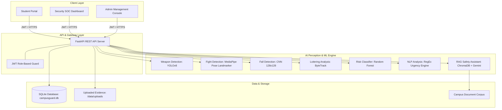

# CampusGuard AI
### AI-Powered Multi-Signal Campus Safety Risk Prediction and Alert Management System

[](https://fastapi.tiangolo.com/)
[](https://vitejs.dev/)
[](https://github.com/ultralytics/ultralytics)
[](https://pytorch.org/)
[](#)

---

## 1. Executive Summary & Abstract

**CampusGuard AI** is an intelligent, multi-signal campus safety risk prediction and alert management system engineered for modern academic institutions. It bridges the gap between reactive security responses and proactive hazard mitigation by unifying:
1. **Computer Vision Threat Intelligence**: Uploaded image and recorded video frame analysis for automated weapon detection (guns, knives), physical fight recognition, slips/falls, restricted zone intrusions, loitering patterns, and after-hours presence.
2. **Multi-Signal Predictive ML Model**: A trained Random Forest Classifier evaluating situational signals to generate a 0–100 Risk Score, Risk Level (`Low`, `Medium`, `High`), and explainable contributing factors.
3. **Incident Lifecycle & Audit Trails**: End-to-end ticket submission with NLP classification, urgency rating, optional photo/document evidence, status transitions, and append-only chronological timeline logs.
4. **Emergency SOS Broadcast**: Instant, location-targeted emergency dispatch alerting campus security in real time.
5. **Campus Safety AI Assistant (RAG)**: Retrieval-Augmented Generation utilizing local campus safety policy documents with zero hallucination and real verified citations.
6. **Role-Based Operations Center**: Distinct, secure workflows tailored for Students, Security Officers, and System Administrators.

---

## 2. System Architecture



---

## 3. Core Modules & Capabilities

### 🔐 1. Authentication & Role-Based Access Control (RBAC)
- **Student**: Access to Emergency SOS, personal incident filing, ticket status tracking, and the AI Safety Assistant. Restricted from camera feeds, administrative settings, and other users' records.
- **Security Officer**: Access to the Security Operations Center (SOC), live active alerts feed, incident resolution controls, CCTV intelligence, safety analytics, and the safety assistant.
- **Administrator**: Full system authority including User Management (CRUD), Camera Infrastructure Management (CRUD), multi-signal campus overview metrics, system audits, and platform settings.

### 🛡️ 2. CCTV Image & Video Intelligence
- **Image Threat Detection**: Upload image frames to detect persons, weapons (guns, knives) with confidence ratings, physical altercations, falls, restricted area breaches, and after-hours presence.
- **Video Loitering Analysis**: Analyze recorded MP4/AVI videos utilizing ByteTrack tracking IDs, calculating dwell time within a 5-second loitering window without fabricating unsupported risk scores.
- **Alert Persistence & Deduplication**: High-severity threat detections automatically generate persistent database alerts with unique Alert IDs while deduplicating recurring events within a 30-second window.

### 🚨 3. Alert Management & Escalation
- **Alert Lifecycle**: Active $\rightarrow$ Acknowledged $\rightarrow$ Escalated $\rightarrow$ Resolved.
- **Assignment**: Directly assign alerts to responding security officers (`assigned_to`).
- **Escalation**: Unacknowledged high-priority alerts can be automatically escalated to critical status or manually escalated by field officers.

### 📋 4. Incident Management & Audit Timelines
- **Filing**: Students submit location, category, description, and optional photo attachments.
- **Automated NLP**: Categorizes reports (Fighting, Medical, Weapon, Fall, Fire, Suspicious) and assigns an Urgency level (`High`, `Normal`).
- **Audit Trails**: Every incident records an append-only chronological timeline (`submitted` $\rightarrow$ `nlp_analyzed` $\rightarrow$ `acknowledged` $\rightarrow$ `resolved`) viewable directly in the details modal.

### 🆘 5. Targeted Emergency SOS
- One-click emergency distress signaling with instant location targeting (Library, Science Complex, Hostel, Cafeteria, Main Gate, Gym).
- Immediate priority broadcast to Security and Admin command centers.

### 🤖 6. AI Campus Safety Assistant (RAG)
- Answers student and staff safety questions regarding campus emergencies, safety escorts, prohibited items, and protocol.
- Retrieves relevant sections from verified campus safety guidelines.
- Produces zero fabricated sources; includes genuine file names, section headers, and cross-encoder relevance scores.

---

## 4. Machine Learning & Model Specifications

| Task | Architecture / Model | Input Format | Evaluation / Metric |
| :--- | :--- | :--- | :--- |
| **Risk Prediction** | Random Forest Classifier (`models/risk_prediction_model.pkl`) | Multi-signal vector (6 features) | 100% Policy-Rule Fit (Synthetic Benchmark)* |
| **Weapon Detection** | Custom YOLOv8n (`backend/ml_models/weapon_detection_trained.pt`) | RGB Images (416x416) | High precision for guns & knives |
| **Fight Recognition** | MediaPipe Multi-Person Pose Landmarker | Normalized 33 landmark skeletons | Distance heuristic $< 0.25$ threshold |
| **Fall Detection** | Deep 2D CNN (`models/fall_detection_cnn.keras`) | 128x128 RGB Image | Evaluated in `docs/ml_results/` |
| **Loitering Detection**| ByteTrack + Spatial Temporal Displacement | Video Frame Sequences (FPS calibrated) | Dwell threshold $\ge 5$ seconds |

Model accuracy, loss curves, and confusion matrix diagrams are preserved in [`docs/ml_results/`](docs/ml_results/).

### ⚠️ AI Model Limitations & Operational Scope
- **Synthetic-Rule-Based Risk Model**: The Random Forest Classifier is trained and evaluated on a synthetic benchmark (`data/risk_dataset.csv`, 2,000 synthetic records) generated from deterministic rule-weighted security factors. Because 6 binary features yield only $2^6 = 64$ discrete input combinations, the 80/20 train/test split samples from identical feature states; thus, the 100% accuracy reflects deterministic policy-rule fitting across the 64 discrete states rather than empirical generalization accuracy to unseen real-world campus crime datasets.
- **Experimental Weapon Detector**: Fine-tuned on the DaSCI weapon benchmark dataset (60 training and 20 validation images). It should be treated as an experimental prototype capable of recognizing clear pistols and knives, but is not certified for industrial surveillance under severe occlusions, extreme distances, or low-light CCTV artifacts.
- **Proximity-Based Fight Recognition**: Utilizes normalized joint distance heuristics (< 0.25 threshold across key landmarks between multiple individuals) via MediaPipe Pose Landmarker. It identifies close physical entanglement and sudden grappling, but does not employ 3D CNN action-recognition models; false positives may occur during dense crowds, dancing, or non-aggressive close contact.
- **RAG First-Run Internet Requirements**: The Campus Safety AI Assistant relies on Hugging Face embeddings (`sentence-transformers/all-MiniLM-L6-v2`) and cross-encoder reranking (`cross-encoder/ms-marco-MiniLM-L-6-v2`). On initial launch, internet access is required to download and cache these model weights into `~/.cache/huggingface/hub/`. Subsequent inferences run locally and offline from the cached weights and local `chroma_db/`.

---

## 5. API Reference Summary

| Method | Endpoint | Access Role | Description |
| :--- | :--- | :--- | :--- |
| `POST` | `/login` | Public | Authenticates user; returns JWT bearer token |
| `GET` | `/health` | Public | System health check and API version status |
| `GET` | `/users` | Admin | Lists all registered accounts |
| `POST` | `/users` | Admin | Creates a new user account |
| `DELETE`| `/users/{id}` | Admin | Deletes user account (prevents self-deletion) |
| `GET` | `/cameras` | Admin, Security | Lists registered camera hardware |
| `POST` | `/cameras` | Admin | Registers new camera location |
| `PATCH` | `/cameras/{id}` | Admin | Toggles camera active/inactive status |
| `GET` | `/incidents` | All Roles | Lists student's own reports or all reports for security |
| `POST` | `/incidents` | All Roles | Submits incident ticket with NLP categorization |
| `POST` | `/incidents/upload` | All Roles | Uploads image/document attachment |
| `GET` | `/incidents/{id}/logs`| All Roles | Retrieves chronological incident audit trail |
| `PATCH` | `/incidents/{id}/status`| Admin, Security| Transitions status (`acknowledged`, `resolved`) |
| `GET` | `/alerts` | Admin, Security | Retrieves all generated safety alerts |
| `PATCH` | `/alerts/{id}/acknowledge`| Admin, Security| Acknowledges alert |
| `PATCH` | `/alerts/{id}/assign` | Admin, Security| Assigns alert to responding officer |
| `PATCH` | `/alerts/{id}/escalate`| Admin, Security| Escalates alert to critical priority |
| `POST` | `/sos` | Student | Dispatches emergency SOS alert |
| `POST` | `/camera/analyze` | Admin, Security| Uploads image for ML detection & threat alerting |
| `POST` | `/camera/analyze-video`| Admin, Security| Analyzes video for loitering patterns |
| `GET` | `/risk/campus-overview` | Admin, Security| Aggregated multi-signal campus safety index |
| `POST` | `/assistant/ask` | All Roles | RAG query answering with verified citations |

---

## 6. Demonstration Credentials

For evaluation, testing, and viva presentations, default seeded accounts are provided:

| Role | Email | Password | Primary Capabilities |
| :--- | :--- | :--- | :--- |
| **Student** | `student@campusguard.com` | `Student@123` | SOS Dispatch, Incident Reporting, My Tickets, Safety Assistant |
| **Security** | `security@campusguard.com` | `Security@123` | SOC Feed, CCTV Uploads, Alert Escalation & Resolution |
| **Administrator** | `admin@campusguard.com` | `Admin@123` | User & Camera Management (CRUD), Multi-Signal Overview, System Audit |

> [!WARNING]
> **SECURITY ADVISORY FOR SEEDED ACCOUNTS**
> The accounts listed above are seeded strictly for initial local evaluation, development, and demonstration purposes. Before deploying CampusGuard AI in any shared, staging, or production environment, **immediately change all default passwords** or remove these accounts via the Admin Console to protect the system from unauthorized access.

---

## 7. Windows Setup & Execution Guide

Follow these step-by-step instructions to run CampusGuard AI on any Windows 10/11 system.

### Prerequisites
1. **Python**: 3.10 to 3.13 (Ensure "Add Python to PATH" was selected during Python installation).
2. **Node.js**: v18.0.0 or higher with `npm` (Download from [nodejs.org](https://nodejs.org/)).
3. **PowerShell** or **Command Prompt** (Run as standard user).

---

### Step 1: Extract and Open Project
Extract the zip package to any folder of your choice (e.g. `C:\Projects\CampusGuard-AI`). Open a PowerShell terminal in the project root directory:

```powershell
cd C:\Path\To\CampusGuard-AI
```

---

### Step 2: Set Up Python Virtual Environment
Create a clean virtual environment and activate it:

```powershell
# Create virtual environment
python -m venv venv

# Activate in PowerShell
.\venv\Scripts\Activate.ps1
# (If script execution is disabled on your system, run: Set-ExecutionPolicy -Scope Process -ExecutionPolicy Bypass; .\venv\Scripts\Activate.ps1)

# Or activate in Command Prompt:
# .\venv\Scripts\activate.bat
```

---

### Step 3: Install Backend Dependencies
Upgrade pip and install all required Python libraries:

```powershell
pip install --upgrade pip
pip install -r requirements.txt
```

---

### Step 4: Configure Environment Variables (`.env`)
Copy `.env.example` to `.env`:

```powershell
Copy-Item .env.example .env
```

Open `.env` in any text editor. You **must** configure `CAMPUSGUARD_SECRET_KEY` with a random secret key (the backend refuses to start with empty or placeholder keys for security).

Generate a secure 64-character hex key directly from PowerShell:
```powershell
python -c "import secrets; print(secrets.token_hex(32))"
```
Paste this generated key into `.env`:
```ini
CAMPUSGUARD_SECRET_KEY=your_generated_64_character_hex_key_here
GEMINI_API_KEY=your_optional_gemini_api_key_here
```
*(Note: `GEMINI_API_KEY` is optional. If left blank, the Campus Safety AI Assistant automatically falls back to local hybrid RAG retrieval from `campus_documents/` without requiring external internet or API access).*

---

### Step 5: Pre-Installed AI Models Verification
All trained machine learning model checkpoints are **pre-packaged and included** in this project:
- **Weapon Detection (Trained YOLOv8)**: `backend/ml_models/weapon_detection_trained.pt` (5.2 MB) & `backend/ml_models/best.pt` (5.2 MB)
- **Person Detection (YOLOv8)**: `backend/ml_models/person_detection.pt` (5.4 MB)
- **Fight Recognition (Landmarker)**: `backend/ml_models/pose_landmarker_lite.task` (5.5 MB)
- **Fall Detection (Deep CNN)**: `models/fall_detection_cnn.keras` (37.9 MB)
- **Risk Prediction (Random Forest)**: `models/risk_prediction_model.pkl` (0.4 MB)

No model training or external model downloads are needed to run the application immediately.

---

### Step 6: Fresh Database Initialization
To maintain maximum portability, security, and clean deployment, pre-existing database files (`campusguard.db`) are excluded from distribution packages. The backend is designed with zero-configuration automatic initialization:

1. **Automatic Initialization on Startup**:
   When the backend server starts (`uvicorn backend.main:app`), SQLAlchemy automatically creates a fresh `campusguard.db` in the project root:
   - `Base.metadata.create_all(bind=engine)` creates all database tables (`users`, `incidents`, `incident_logs`, `alerts`, `cameras`).
   - `run_migrations()` checks for and applies schema alterations (such as `operational_score`, `assigned_to`, `escalated`, `attachment`, `alert_id`).
   - `seed_users()` automatically provisions the default evaluation accounts (`student@campusguard.com`, `security@campusguard.com`, `admin@campusguard.com`).

2. **Manual Pre-Initialization (Optional)**:
   To explicitly create and migrate the database before launching the server:
   ```powershell
   python -m backend.database.migrate_schema
   python -m backend.seed
   ```

---

### Step 7: Run System Diagnostic Check
Run the included automated health verification script to ensure all dependencies, models, and configuration files are valid:

```powershell
python check_setup.py
```
This script will inspect all 7 system layers and confirm that your environment is ready to start.

---

### Step 8: Start Backend Server (Terminal 1)
In your activated virtual environment terminal:

```powershell
uvicorn backend.main:app --host 127.0.0.1 --port 8000 --reload
```
The FastAPI backend will start on **`http://127.0.0.1:8000`**.
- Swagger Interactive Documentation: [http://127.0.0.1:8000/docs](http://127.0.0.1:8000/docs)
- ReDoc API Reference: [http://127.0.0.1:8000/redoc](http://127.0.0.1:8000/redoc)

---

### Step 9: Start Frontend Application (Terminal 2)
Open a **new** terminal window and navigate to the `frontend-new` folder:

```powershell
cd C:\Path\To\CampusGuard-AI\frontend-new

# Install frontend dependencies
npm install

# Launch Vite development server
npm run dev
```
Open **[http://localhost:5173](http://localhost:5173)** in Google Chrome, Microsoft Edge, or Firefox.

Log in using any of the demo accounts (Student, Security, or Admin) to access the complete interactive interface.

---

### Step 10: Run Automated Tests & Build Verification
CampusGuard AI features a comprehensive multi-layered test suite. In the reported validation:
- **Full Unit Test Suite**: **132 / 132 tests passed (100% Passed)** across all 12 test suites.
- **API Verification Suite**: **11 / 11 test sections passed (100% Verified)** covering public endpoints, RBAC, users CRUD, cameras CRUD, incident lifecycles, emergency SOS, alert escalation, multi-signal risk intelligence, duplicate prevention, and RAG retrieval.
- **Frontend Production Build**: Vite build succeeded in 878ms with zero errors.

To run the unit test collection:
```powershell
# In activated virtual environment:
python -m unittest discover -s tests -p "test_*.py" -v
```

To run the automated API verification suite:
```powershell
python backend/test_api_suite.py
```

To verify the production frontend build:
```powershell
cd frontend-new
npm run build
```

---

## 8. Presentation & Viva Talking Points

1. **Why Multi-Signal?** Rather than relying on isolated camera feeds, CampusGuard AI fuses student crowdsourced incident reports, emergency SOS alerts, automated CCTV detections, time-of-day parameters, and restricted perimeter tracking into a unified risk score.
2. **Explainable AI (XAI)**: In addition to a predictive score, the system breaks down the exact contributing risk factors (+50 pts Weapon, +40 pts Altercation, etc.) so security officers know *why* an alert was generated.
3. **Zero-Hallucination Assistant**: The safety assistant strictly references indexed university safety guidelines. If a topic is not covered in the safety documents, it states so transparently instead of fabricating policies.
4. **Data Integrity & Privacy**: Student identities are guarded from unauthorized inspection, and incident audit trails are chronologically preserved for post-incident review and accountability.

---

## 9. Academic Defense & Viva Documentation
For comprehensive 3rd-semester project evaluation, architecture diagrams, ER schemas, empirical ML evaluations, and 25 curated Viva Voce questions & answers, refer to:
👉 **[`docs/SEMESTER_EXAM_DOCUMENTATION.md`](docs/SEMESTER_EXAM_DOCUMENTATION.md)**

