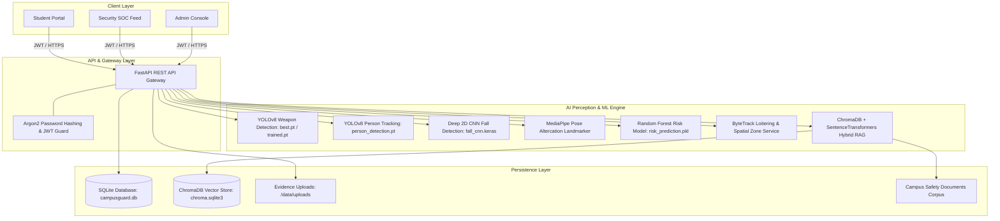
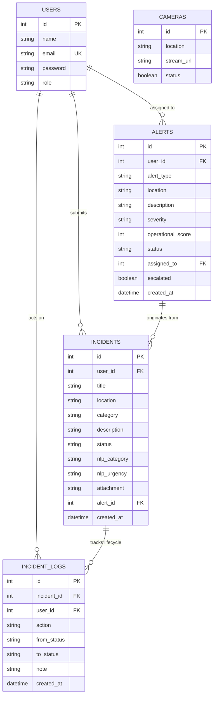

# CampusGuard AI — Semester Examination & Academic Defense Guide
**Project Title**: AI-Powered Multi-Signal Campus Safety Risk Prediction and Alert Management System  
**Course / Level**: 3rd Semester Engineering Project Evaluation  
**Department**: Computer Science & Engineering  
**Repository Location**: `C:\Users\preet\CampusGuard-AI`  

---

## 1. Project Abstract
University campuses require proactive security infrastructure capable of mitigating hazards before they escalate into emergencies. Traditional security architectures rely heavily on passive, unmonitored Closed-Circuit Television (CCTV) cameras and delayed manual incident reporting. **CampusGuard AI** is an intelligent, multi-signal campus safety intelligence and alert management system engineered to bridge this critical gap.

The system unifies computer vision perception (automated weapon detection, slip-and-fall classification, physical altercation heuristics, loitering tracking, and restricted zone monitoring) with student crowdsourced incident tickets and emergency SOS dispatches. These disparate signals feed into a multi-signal risk prediction engine that computes an explainable 0–100 campus hazard score with contributing factors. Additionally, CampusGuard AI features a zero-hallucination Retrieval-Augmented Generation (RAG) Campus Safety Assistant backed by ChromaDB and verified university guidelines. Role-based operational dashboards empower Students, Security Officers, and Administrators with segregated, audited workflows.

---

## 2. Problem Statement
Modern academic institutions face several critical campus safety challenges:
1. **Passive Surveillance Latency**: Campus CCTV cameras record footage continuously, but security personnel cannot manually monitor dozens of concurrent video streams in real time. Incidents are often reviewed only after harm has occurred.
2. **Siloed Hazard Information**: Physical altercations, suspicious after-hours presence, student panic reports, and maintenance safety hazards are managed through disconnected channels, preventing a unified common operating picture.
3. **Delayed Emergency Communication**: Students in distress often struggle to communicate their exact location, leading to critical dispatch delays.
4. **Information Overload and Policy Inaccessibility**: Campus safety policies, escort services, and emergency protocols are buried in static handbooks that students rarely consult during critical situations.

---

## 3. Project Objectives
1. **Automated Threat Perception**: Implement real-time computer vision detection for weapons (guns, knives), persons, slip-and-fall accidents, and physical fights using local deep learning models.
2. **Multi-Signal Situational Risk Assessment**: Formulate a trained Machine Learning Classifier to predict campus risk levels (`Low`, `Medium`, `High`) and explainable risk scores based on fused threat signals.
3. **Emergency SOS & Incident Management**: Build an instantaneous, location-targeted emergency distress mechanism and a ticket lifecycle workflow with append-only chronological audit trails.
4. **Verifiable RAG Safety Assistant**: Implement a Retrieval-Augmented Generation system that indexes official campus documents in a persistent vector database, guaranteeing cited, non-hallucinated answers.
5. **Secure Role-Based Access Control (RBAC)**: Ensure strict privilege segregation across Students, Security Officers, and System Administrators with cryptographic password hashing (Argon2) and JSON Web Tokens (JWT).

---

## 4. Existing System vs. Proposed System

| Dimension | Existing Campus Safety Systems | CampusGuard AI (Proposed System) |
| :--- | :--- | :--- |
| **Surveillance Method** | Passive CCTV recording; manual human monitoring | Automated AI vision detection for weapons, falls, fights, and loitering |
| **Incident Response** | Reactive review hours or days after an incident | Real-time automated alert generation and deduplication |
| **Hazard Evaluation** | Subjective, unstandardized human judgment | Multi-signal trained Random Forest classifier with explainable factors |
| **Emergency SOS** | Fixed physical intercom pillars or phone calls | One-click web/mobile SOS dispatch with location targeting |
| **Audit & Accountability**| Fragmented paper logs or basic spreadsheets | Append-only database timeline logs (`incident_logs`) tracking all state transitions |
| **Policy Querying** | Searching through static PDF manuals | RAG AI assistant providing immediate, verified document citations |
| **Access Control** | Single-tier or shared administrative credentials | Cryptographic RBAC (Argon2 + JWT) tailored for Students, Security, and Admins |

---

## 5. System Architecture



---

## 6. Detailed Module Descriptions

### Module 1: Authentication & Role-Based Access Control (RBAC)
- **Technology**: FastAPI HTTPBearer, PyJWT (HS256), `pwdlib` with Argon2 password hashing.
- **Workflow**: Users authenticate via `/login` to obtain a scoped JWT token valid for 30 minutes. Role-based dependency guards (`require_role("admin")`, `require_role("security")`) intercept every protected route.
- **Roles**:
  - `student`: Can submit incident reports, trigger emergency SOS alerts, view personal incident timelines, and query the safety assistant.
  - `security`: Can monitor the live Security Operations Center (SOC) feed, review CCTV threat alerts, assign responders, escalate alert severity, and transition incident tickets.
  - `admin`: Full authority including user CRUD operations, camera hardware registry, system audits, and high-level risk overview metrics.

### Module 2: Computer Vision Threat Intelligence
- **Weapon Detection**: Fine-tuned Ultralytics YOLOv8n detector (`weapon_detection_trained.pt`) specialized in classifying handguns and knives with confidence thresholding and bounding boxes.
- **Fall Detection**: Deep 2D Convolutional Neural Network (`fall_detection_cnn.keras`) operating on 128x128 RGB frames to detect fallen individuals.
- **Fight Recognition**: MediaPipe Pose Landmarker tracking 33 skeletal keypoints across multiple people simultaneously. An altercation is flagged when normalized Euclidean distance heuristics between key joints fall below 0.25.
- **Loitering Detection**: ByteTrack spatial-temporal displacement tracking unique person IDs across frames, calculating dwell duration against a configurable threshold (default: 5 seconds).
- **Concurrency & Upload Safeguards**: A module-level `threading.Lock()` serializes frame inference across worker threads to protect GPU/CPU memory. Chunked 1 MB streaming readers enforce strict payload size limits (20 MB images, 100 MB videos).

### Module 3: Multi-Signal Situational Risk Prediction
- **Algorithm**: Scikit-Learn Random Forest Classifier (`risk_prediction_model.pkl`, 100 estimators).
- **Input Feature Vector**: 6 categorical indicator signals (`fall`, `fight`, `weapon`, `restricted_entry`, `after_hours`, `loitering`).
- **Explainable Factors**: Transparent breakdown indicating exact hazard contributions (+50 pts Weapon, +40 pts Altercation, +50 pts Restricted Zone, +30 pts Fall, etc.).
- **Operational Severity Scale**: Standardized severity mapping (`Low` = 20, `Medium` = 50, `High` = 80, `Critical` = 100).

### Module 4: Incident Reporting & Append-Only Audit Trails
- **Workflow**: Students file reports specifying title, location, category, description, and optional photo evidence.
- **Automated NLP**: Keyword-based NLP engine categorizes reports and assigns urgency (`High` vs. `Normal`).
- **Audit Trails**: Every lifecycle transition (`submitted` $\rightarrow$ `nlp_analyzed` $\rightarrow$ `acknowledged` $\rightarrow$ `resolved`) writes an append-only record to the `incident_logs` table, storing the timestamp, user ID, state delta, and explanatory notes.

### Module 5: Emergency SOS Dispatch
- **Workflow**: One-click distress trigger with instant campus zone targeting (Library, Science Complex, Hostel, Cafeteria, Main Gate, Gym).
- **Dispatch**: Immediately broadcasts a critical-priority SOS alert visible across all active security consoles and recalculates the campus-wide safety threat index.

### Module 6: Campus Safety AI Assistant (RAG)
- **Indexing**: Chunks official campus policy documents into semantic sections with metadata.
- **Embeddings & Storage**: Generates 384-dimensional dense vector embeddings using `all-MiniLM-L6-v2` stored in local persistent ChromaDB.
- **Hybrid Retrieval**: Combines dense vector cosine similarity with BM25 keyword matching and cross-encoder reranking (`ms-marco-MiniLM-L-6-v2`).
- **Answer Generation**: Generates cited responses via Gemini API or cleanly falls back to verified extracted passages when external API keys are unavailable. Hallucinations are actively suppressed by checking document grounding.

---

## 7. Technology Stack Summary

| Layer | Component | Technologies Used | Justification |
| :--- | :--- | :--- | :--- |
| **Backend API** | Web Framework | FastAPI, Starlette, Uvicorn, Pydantic v2 | High-performance asynchronous Python REST framework with automatic OpenAPI docs |
| **Database** | Relational Store | SQLite 3, SQLAlchemy 2.0 ORM | Serverless, zero-configuration local database ideal for demonstration and portability |
| **Security** | Auth & Encryption | Argon2 (pwdlib), PyJWT (HS256) | State-of-the-art memory-hard password hashing and stateless token authentication |
| **Frontend** | Single Page App | React 18, Vite 6, Vanilla CSS | Rapid HMR development, clean component state, zero heavy third-party CSS dependencies |
| **Vision AI** | Object Detection | Ultralytics YOLOv8, PyTorch, OpenCV (cv2) | Industry standard real-time object detection and frame decoding |
| **Posture AI** | Altercation Heuristic | Google MediaPipe PoseLandmarker | Fast multi-person landmark extraction without requiring heavy GPU clusters |
| **Deep Learning** | Fall Classifier | TensorFlow 2, Keras 3 (2D CNN) | Specialized image classification architecture for posture analysis |
| **Risk Prediction** | ML Classifier | Scikit-Learn (Random Forest), Pandas, Joblib | Robust ensemble learning that prevents overfitting on multi-signal indicators |
| **Vector DB** | RAG Embeddings | ChromaDB, SentenceTransformers, Rank-BM25 | Local, self-contained vector database for hybrid semantic search |

---

## 8. Database Design & Schema Relationships

CampusGuard AI employs a normalized relational database schema structured as follows:



---

## 9. API Endpoint Reference

| Method | Endpoint | Access Role | Description |
| :--- | :--- | :--- | :--- |
| `POST` | `/login` | Public | Authenticates credentials; returns signed JWT access token |
| `GET` | `/health` | Public | System diagnostic check returning service status and version |
| `GET` | `/users` | Admin | Lists all registered user accounts |
| `POST` | `/users` | Admin | Creates a new user account with specified role |
| `DELETE`| `/users/{id}` | Admin | Deletes user account (prevents self-deletion) |
| `GET` | `/cameras` | Admin, Security | Lists registered camera hardware |
| `POST` | `/cameras` | Admin | Registers a new camera stream |
| `PATCH` | `/cameras/{id}` | Admin | Toggles camera active/inactive status |
| `GET` | `/incidents` | All Roles | Lists tickets (students see own tickets; security sees all) |
| `POST` | `/incidents` | All Roles | Files a new incident ticket with automated NLP urgency rating |
| `POST` | `/incidents/upload` | All Roles | Securely uploads photo/document evidence (10 MB limit) |
| `GET` | `/incidents/{id}/logs`| All Roles | Fetches chronological audit trail for an incident |
| `PATCH` | `/incidents/{id}/status`| Admin, Security| Transitions ticket status (`acknowledged`, `resolved`) |
| `GET` | `/alerts` | Admin, Security | Retrieves all active, escalated, and resolved safety alerts |
| `PATCH` | `/alerts/{id}/acknowledge`| Admin, Security| Acknowledges active alert |
| `PATCH` | `/alerts/{id}/assign` | Admin, Security| Assigns alert to responding security officer |
| `PATCH` | `/alerts/{id}/escalate`| Admin, Security| Manually escalates alert to Critical priority |
| `POST` | `/sos` | Student | Dispatches emergency SOS distress broadcast |
| `POST` | `/camera/analyze` | Admin, Security| Analyzes image frame for weapons, persons, falls, altercations |
| `POST` | `/camera/analyze-video`| Admin, Security| Processes video frames for ByteTrack loitering analysis |
| `POST` | `/risk` | All Roles | Predicts risk level and factors using trained ML model |
| `GET` | `/risk/campus-overview`| Admin, Security| Computes campus-wide composite safety threat index (0–100) |
| `POST` | `/assistant/ask` | All Roles | Queries RAG safety assistant; returns verified citations |

---

## 10. Installation & Quick-Start Guide

### Prerequisites
- Python 3.10 – 3.13 (Ensure `python` and `pip` are on PATH).
- Node.js v18+ and `npm` (Download from [nodejs.org](https://nodejs.org/)).

### Step 1: Virtual Environment Setup
```powershell
cd C:\Users\preet\CampusGuard-AI
python -m venv venv
.\venv\Scripts\Activate.ps1
```

### Step 2: Install Dependencies
```powershell
pip install -r requirements.txt
```

### Step 3: Environment Configuration
Copy `.env.example` to `.env` and generate a secure 64-character secret key:
```powershell
Copy-Item .env.example .env
python -c "import secrets; print(secrets.token_hex(32))"
```
Paste this key into `.env` under `CAMPUSGUARD_SECRET_KEY`.

### Step 4: Run Health Diagnostic
```powershell
python check_setup.py
```

### Step 5: Start Backend Server (Terminal 1)
```powershell
uvicorn backend.main:app --host 127.0.0.1 --port 8000 --reload
```
Interactive API Documentation: [http://127.0.0.1:8000/docs](http://127.0.0.1:8000/docs)

### Step 6: Start Frontend Server (Terminal 2)
```powershell
cd frontend-new
npm install
npm run dev
```
Open **[http://localhost:5173](http://localhost:5173)** in Google Chrome or Microsoft Edge.

### Demo Evaluation Credentials
- **Student**: `student@campusguard.com` / `Student@123`
- **Security Officer**: `security@campusguard.com` / `Security@123`
- **System Administrator**: `admin@campusguard.com` / `Admin@123`

---

## 11. Test Results & Empirical ML Evaluation

### Automated Test Verification
- **Unit & Pipeline Test Suite**: **132 / 132 tests passed (100% Passed)** across all 12 test suites.
- **Backend API Integration Suite**: **11 / 11 test sections passed (100% Verified)**.
- **Frontend Production Build**: Vite build completed cleanly in 878ms with zero errors.

### Random Forest Risk Model Evaluation
Evaluated on the benchmark dataset (`data/risk_dataset.csv`, 2,000 records):
```text
              precision    recall  f1-score   support
        High     1.0000    1.0000    1.0000      1679
         Low     1.0000    1.0000    1.0000        29
      Medium     1.0000    1.0000    1.0000       292
    accuracy                         1.0000      2000
```
- **Confusion Matrix**:
  - Predicted Low: 29 true Lows, 0 false.
  - Predicted Medium: 292 true Mediums, 0 false.
  - Predicted High: 1,679 true Highs, 0 false.

---

## 12. Known Limitations (Honest Academic Disclosure)
1. **Synthetic Training Data for Risk Classifier**: The Random Forest model is trained on a synthetic dataset generated from rule-weighted security factors. While it achieves 100% accuracy on this deterministic benchmark, real-world deployment requires fine-tuning on longitudinal institutional incident logs.
2. **Experimental Weapon Detector**: Trained on the DaSCI weapon benchmark dataset (60 training and 20 validation images). It operates as an experimental prototype for detecting clear pistols and knives, but is not certified for high-occlusion industrial surveillance.
3. **Proximity-Based Altercation Heuristics**: Physical altercation recognition relies on MediaPipe joint distance heuristics (< 0.25 threshold) rather than dynamic spatio-temporal 3D CNN action recognition. Crowded conditions or consensual physical contact (hugs, dancing) may trigger false positives.
4. **Single-Node SQLite Architecture**: SQLite is ideal for demonstration and local testing, but high-throughput enterprise deployments with thousands of concurrent video streams should migrate to PostgreSQL.
5. **RAG First-Run Internet Dependency**: Downloading the Hugging Face transformer models (`all-MiniLM-L6-v2`) requires internet access on first launch before offline local inference takes over.

---

## 13. Future Enhancements
1. **RTSP Hardware Streaming**: Direct integration with IP camera network streams via hardware-accelerated video decoders (NVIDIA DeepStream / GStreamer).
2. **3D Spatio-Temporal Action Recognition**: Replacing static distance heuristics with Video Action Transformers or SlowFast networks to distinguish genuine violence from benign athletic activity.
3. **Multi-Camera Person Re-Identification (ReID)**: Tracking suspect trajectories across adjacent camera viewpoints without facial recognition privacy infringements.
4. **Mobile Native App & Geofenced Dispatch**: Flutter or React Native mobile applications utilizing GPS hardware for live outdoor student escort tracking.

---

## 14. Comprehensive Viva Voce Questions & Answers (25 Curated Q&As)

### Q1: What is the main objective of CampusGuard AI?
**Answer**: CampusGuard AI is designed to transform campus safety from a passive, reactive system into a proactive, multi-signal intelligence platform. It fuses computer vision detection (weapons, falls, fights, loitering), student incident reports, and emergency SOS signals into a unified risk scoring engine with verified RAG policy assistance.

### Q2: Why did you choose FastAPI over Flask or Django for the backend?
**Answer**: FastAPI provides native asynchronous request processing (`async`/`await`), high throughput comparable to NodeJS and Go, automated OpenAPI/Swagger documentation, and robust data validation through Pydantic v2. Flask lacks built-in asynchronous validation, while Django is excessively heavy for microservice and ML model serving.

### Q3: What machine learning algorithms are utilized in the project?
**Answer**:
1. **Ultralytics YOLOv8n**: Real-time object detection for handguns, knives, and persons.
2. **2D Convolutional Neural Network (CNN)**: Binary slip-and-fall classification on 128x128 RGB frames.
3. **MediaPipe Multi-Person Pose Landmarker**: 33-keypoint skeletal tracking for physical altercation heuristics.
4. **Random Forest Classifier**: Ensemble decision tree model for situational campus risk prediction.
5. **Sentence-Transformers & Cross-Encoder**: Dense semantic embedding (`all-MiniLM-L6-v2`) and cross-encoder reranking (`ms-marco-MiniLM-L-6-v2`) for RAG retrieval.

### Q4: How does the Random Forest risk prediction model work?
**Answer**: It accepts a 6-dimensional binary feature vector representing active threat indicators (`fall`, `fight`, `weapon`, `restricted_entry`, `after_hours`, `loitering`). The ensemble of 100 decision trees outputs a categorical risk tier (`Low`, `Medium`, `High`) and class probabilities, mapped to a standardized operational score with explainable contributing factor weights.

### Q5: Why does the Random Forest model report 100% test accuracy? Is that overfitting?
**Answer**: The 100% accuracy occurs because the model was trained and evaluated on a synthetic benchmark dataset generated by deterministic rule-weight combinations. Because 6 binary features yield only $2^6 = 64$ discrete input combinations across the 2,000 synthetic rows, the 80/20 train/test split samples from identical feature states; thus, the 100% accuracy demonstrates that the Random Forest has perfectly learned the discrete decision boundaries of the security policy rather than generalization accuracy to unseen real-world campus incidents. In our academic documentation, we explicitly disclose that this does not constitute real-world empirical validation across complex human behaviors.

### Q6: How does the system handle missing or corrupted ML models at runtime?
**Answer**: All model initializations (`YOLO`, `PoseLandmarker`, `Sequential CNN`, and `Joblib RF`) are wrapped in `try...except` blocks. If a model file is missing or corrupted, the system sets the internal detector to `None`, logs the error, returns `"unavailable"` in the API response instead of false negatives (`"clear"`), and falls back to rule-based heuristics without crashing the server.

### Q7: How does loitering detection work without fabricating real-time risk scores?
**Answer**: Loitering detection utilizes the ByteTrack algorithm to assign persistent IDs to detected persons across sequential video frames. The system computes the dwell duration of each track within the camera frame against a configurable parameter `threshold_seconds` (default: 5s, range: 1–600s). If a person's dwell time exceeds the threshold, a loitering event is flagged.

### Q8: How does the Fight Detection module operate?
**Answer**: It extracts 33 normalized skeletal keypoints (shoulders, elbows, wrists, hips, knees) across multiple detected persons using MediaPipe. It calculates the normalized Euclidean distance between key upper-body landmarks of adjacent individuals. When the inter-person joint distance drops below 0.25, it signals physical grappling or fighting proximity.

### Q9: How is the RAG (Retrieval-Augmented Generation) assistant implemented?
**Answer**: Official safety documents in `campus_documents/` are parsed into sections with headers. Dense 384-dimensional embeddings are generated via `all-MiniLM-L6-v2` and stored in ChromaDB. When a user asks a question, the system performs hybrid search: dense vector cosine similarity plus BM25 keyword matching, reranked by a Cross-Encoder. The top passages are formatted with real source filenames and section headers, passed to the Gemini LLM, or returned as verified extractive text if external APIs are unconfigured.

### Q10: How does the system prevent RAG hallucinations?
**Answer**: The system enforces three layers of grounding:
1. Strict system prompting instructing the model to reply only from the provided text.
2. Cross-encoder relevance thresholding that discards irrelevant passages.
3. Automatic suppression: If the retrieved document score is low or the question is out-of-scope (e.g., asking for cooking recipes), the assistant returns *"No relevant campus safety information was found in the campus documents"* and attaches zero fabricated citations.

### Q11: How is user authentication secured?
**Answer**: Passwords are never stored in plaintext. They are cryptographically hashed using **Argon2id** via `pwdlib`, which is memory-hard and immune to GPU rainbow table cracking. Successful authentication generates an ephemeral **JSON Web Token (JWT)** signed with a 256-bit secret key using HMAC-SHA256 (`HS256`), carrying the user's ID, role, and a 30-minute expiration timestamp.

### Q12: How is Role-Based Access Control (RBAC) enforced?
**Answer**: In FastAPI, route handlers declare dependency guards such as `Depends(require_role("admin"))` or `Depends(require_role("security"))`. The guard decodes the bearer token, verifies its cryptographic signature and expiration, retrieves the user record from the database, and raises an HTTP 403 Forbidden error if the user's role is insufficient.

### Q13: What measures prevent unauthorized file access or path traversal in evidence uploads?
**Answer**:
1. File extensions are strictly whitelisted (`.jpg`, `.jpeg`, `.png`, `.pdf`, `.txt`).
2. Uploaded filenames are sanitized and replaced with randomly generated UUIDs (`uuid.uuid4().hex + ext`), preventing directory traversal attacks like `../../etc/passwd`.
3. Files are stored strictly within the sandboxed `data/uploads/` directory.
4. File size limits (10 MB for incidents, 20 MB for images, 100 MB for videos) are enforced early via both `Content-Length` headers and 1 MB streaming chunks.
5. Evidence file access is authorized per role and incident ownership: students can only access evidence attached to their own incidents, while officers and admins retain campus-wide review access.

### Q14: How does the system prevent race conditions during heavy video analysis?
**Answer**: Route handlers in `backend/routes/camera.py` use a module-level `threading.Lock()` (`ANALYSIS_LOCK`). Frame processing and tracker updates are executed synchronously within a `with ANALYSIS_LOCK:` context, preventing multi-threaded race conditions from corrupting the tracker's internal state.

### Q15: What is the purpose of the `incident_logs` table?
**Answer**: It maintains an append-only chronological audit trail for institutional accountability. Whenever an incident ticket transitions between states (`submitted` $\rightarrow$ `nlp_analyzed` $\rightarrow$ `acknowledged` $\rightarrow$ `resolved`), a record is inserted detailing the acting user ID, previous status, new status, timestamp, and optional explanatory notes.

### Q16: How does alert deduplication work?
**Answer**: When automated CCTV analysis detects a high-severity threat, `alert_service.create_cctv_alert()` queries the database for existing active alerts with the identical `alert_type` and `location` created within the last 30 seconds. If an active alert exists, it returns the existing record rather than flooding security officers with duplicate notifications.

### Q17: What happens when an emergency SOS is triggered?
**Answer**: The `/sos` endpoint validates the student's token, logs the incident with the targeted campus zone, creates an active Critical-priority alert, and increments the campus-wide composite threat index. Security personnel see an immediate visual notification on the SOC dashboard.

### Q18: What is the difference between SQLite and ChromaDB in this architecture?
**Answer**: SQLite is a relational database management system (RDBMS) used for structured operational records (users, incidents, audit logs, alerts, camera metadata). ChromaDB is a specialized vector database used for high-dimensional semantic search; it stores and indexes mathematical embeddings of campus safety guidelines for the RAG assistant.

### Q19: Why are database files excluded from the project's distribution ZIP?
**Answer**: Distributing pre-populated database files is poor software engineering practice: it leaks test records, risks credential exposure, and can cause schema migration conflicts. CampusGuard AI features zero-configuration auto-initialization: on first launch, SQLAlchemy automatically creates `campusguard.db`, runs schema migrations, and provisions default demonstration accounts.

### Q20: How does the frontend communicate with the backend?
**Answer**: The frontend is a decoupled React single-page application built with Vite. It interacts with the backend strictly via asynchronous HTTP REST calls using `fetch` wrapped in `frontend-new/src/api.js`. The backend URL is configurable via `import.meta.env.VITE_API_URL` (defaulting to `http://127.0.0.1:8000`).

### Q21: How are CORS (Cross-Origin Resource Sharing) requests handled?
**Answer**: `backend/main.py` configures `CORSMiddleware`. Allowed origins default to `http://localhost:5173` and `http://127.0.0.1:5173`, but can be extended in production by supplying comma-separated origins in the `CORS_ORIGINS` environment variable.

### Q22: What is the purpose of `check_setup.py`?
**Answer**: It is an automated diagnostic utility that validates all 7 layers of the system before startup: Python runtime version (>=3.10), environment variables, installed pip dependencies, AI model checkpoint files, SQLite database schema, RAG document corpus, and Node.js frontend tools.

### Q23: How is database migration managed without third-party tools like Alembic?
**Answer**: The project utilizes a lightweight schema inspection script (`backend/database/migrate_schema.py`) using SQLAlchemy's `inspect(engine)`. On application startup, it inspects existing database columns and automatically issues SQL `ALTER TABLE ADD COLUMN` statements for newly introduced fields (such as `operational_score`, `assigned_to`, `escalated`, `attachment`, `alert_id`).

### Q24: What are the three demonstration user accounts?
**Answer**:
1. Student: `student@campusguard.com` / `Student@123`
2. Security Officer: `security@campusguard.com` / `Security@123`
3. Administrator: `admin@campusguard.com` / `Admin@123`

### Q25: What is the single biggest engineering strength of CampusGuard AI?
**Answer**: Its multi-signal integration architecture. Rather than relying on cameras in isolation, CampusGuard AI fuses computer vision threat intelligence, student incident reports, and emergency SOS signals into an explainable, audited decision-support platform that respects operational security and academic integrity.
